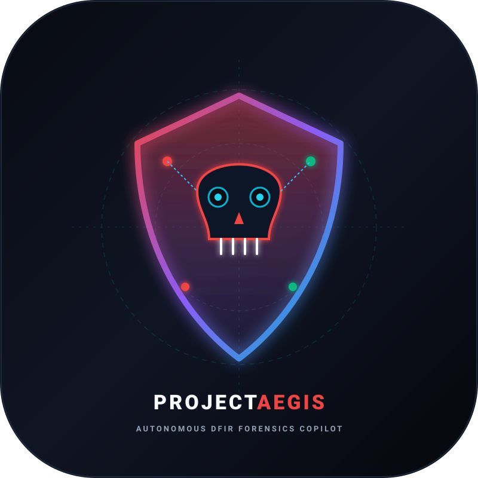
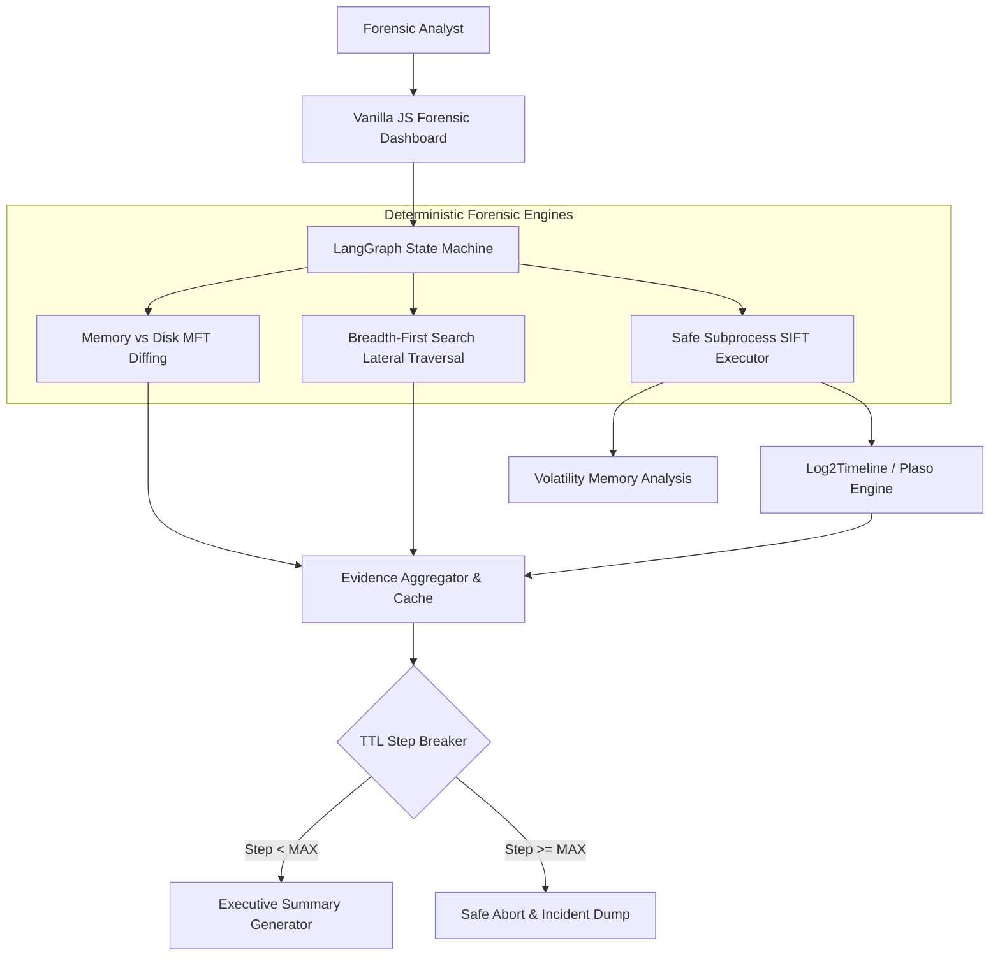

<p align="center">
  
</p>

<h1 align="center">Project Aegis (Evil-Dead)</h1>

<p align="center">
  <strong>Autonomous SIFT Digital Forensics and Incident Response (DFIR) Copilot.</strong>
</p>

<p align="center">
  
  
  
  
  <a href="future.md"></a>
</p>

---

## ⚡ Overview & Problem Statement

**Project Aegis** is an autonomous, reliable AI copilot for Digital Forensics and Incident Response (DFIR) analysts operating inside a SANS SIFT forensic workstation environment.

### 🛡️ Safety & Reliability Principles
- **No Direct Shell Injections**: All forensic commands (`volatility`, `log2timeline`) are executed strictly via `subprocess.run(shell=False)` with argument arrays to prevent shell escaping or command injections.
- **Context Protection**: Huge raw log text walls are piped through Python's `jc` (JSON Convert) library to convert CLI stdout into structured JSON, which is then cached locally. Only paths and condensed metadata enter the LLM context.
- **State Safety**: LangGraph-controlled execution enforces an immutable step counter. If execution cycles hit `MAX_STEPS` (5), a **TTL Circuit Breaker** triggers, halting analysis to prevent loops and outputting a compiled markdown report.

During incidents, responders are overwhelmed by data volume, and LLMs hallucinate when interpreting raw text logs. Aegis delegates heavy parsing and anomaly search to deterministic Python logic, freeing the LLM to write high-level executive reports based on clean, structured findings.

---

## 🏗️ System Architecture



---

## 🔍 Key Forensic Engines

- **Deterministic Discrepancy Diffing (`aegis/diffing.py`)**:
  - Compares volatile memory processes (`windows.pslist`) with filesystem Master File Table (`MFT`) disk timestamps.
  - Flags processes running in memory that lack disk MFT creation records or have start times predating disk creation (revealing process hollowing, reflective loading, or memory-only payloads).
- **Forensic Flood-Fill BFS (`aegis/traversal.py`)**:
  - Performs a Breadth-First Search (BFS) over system authentication and network log files starting at "Patient Zero".
  - Automatically maps lateral movement blast radiuses, validating chronological propagation paths.
- **LangGraph Stateful Orchestrator (`aegis/orchestrator.py`)**:
  - Models triage, collection, analysis, and routing phases of DFIR as a state graph.
  - Implements conditional circuit-breaker logic based on step count.

---

## 🖥️ Interactive Web Dashboard

Located in the `dashboard/` directory. Zero frameworks or complex bundlers required—built entirely on HTML5, CSS3, and Vanilla JS.
- **Live Agent Simulation**: Watch the LangGraph state machine trace compromised hosts, query targets, and execute secure SIFT commands.
- **BFS Lateral Movement Map**: SVG-rendered network tree highlighting compromise nodes, clean analyzed endpoints, and active traversal paths.
- **Process Discrepancies Panel**: Tabulates memory-vs-disk MFT discrepancies.
- **Circuit Breaker HUD**: Displays step counter meter. Flashes red and alerts responder with an Executive Markdown report modal when the execution limit is hit.

---

## 🧪 Verification & Testing

Verify the integrity of all codebases, safety membranes, and deterministic diffing models via the pre-built `pytest` suite:

```bash
# Set mock environment for non-SIFT environments
export AEGIS_MOCK=1

# Execute all tests
PYTHONPATH=. pytest -v tests/test_aegis.py
```

### Test Coverage Results:
- `test_safe_execute_command_mock`: Validates secure execution fallback logic when SIFT tools are missing.
- `test_safe_execute_command_shell_safety`: Ensures command injection inputs do not expand.
- `test_discrepancy_diffing`: Validates memory-only payload alerts.
- `test_lateral_traversal`: Asserts BFS lateral movement graphs correctly identify propagation paths.
- `test_langgraph_ttl_circuit_breaker`: Verifies the LangGraph orchestrator terminates and reports on TTL circuit break events.

---

## 🔮 Engineering Roadmap

To explore planned features including Volatility 3 kernel symbol extraction, DuckDB analytical super-timelines, and GNN lateral threat hunting, read [future.md](future.md).

---

## 📄 License

This project is licensed under the MIT License.
